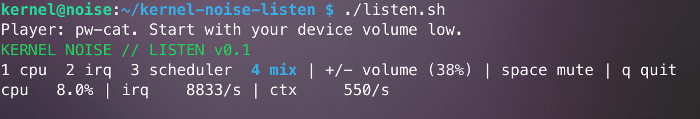

# Kernel Noise — listen to your Linux system

A small experimental instrument that turns Linux activity into live sound.



Run it, then open an application, copy files or start a compile in another terminal. Switch between the layers and listen to what changes.

```bash
./listen.sh
```

The first run compiles a small C program. You need Linux, Bash, a C compiler and one audio player. No root, Python packages, accounts or sample downloads are needed to run it. Start with your device volume low.

## Dependencies

If you already have a compiler and an audio player, skip this step. On Debian, Ubuntu or Raspberry Pi OS:

```bash
sudo apt update
sudo apt install build-essential alsa-utils
./listen.sh
```

The launcher uses an installed `pw-cat`, `paplay`, `aplay` or `ffplay` and your default output. Check the setup without making sound: `./listen.sh --check`.

## Controls

| Key | Sound / action |
| --- | --- |
| `1` | CPU drone |
| `2` | Interrupt-rate percussion |
| `3` | Context-switch-rate percussion |
| `4` / `m` | Mix / cycle modes |
| `+` / `-` | Volume |
| Space | Mute |
| `q` / Ctrl+C | Stop |

The controls menu highlights the selected mode in **bold** and shows a dimmed volume percentage beside `+/- volume`. This is the instrument's gain, not your system speaker volume: **100% corresponds to `--volume 0.4`** (the default `0.15` displays as about 38%).

## Record a take

```bash
./listen.sh --record my-machine.wav --duration 20
```

This records while you listen. To save without playback:

```bash
./listen.sh --render my-machine.wav --duration 20
```

Existing recordings are never overwritten. Output is stereo 48 kHz, 16-bit WAV.

## What makes the sound?

CPU utilization changes a drone's pitch and timbre. Interrupt and context-switch rates change two pulse densities. These are counters from `/proc/stat`, sampled roughly every 50 ms; the pulses do not reproduce individual event timestamps.

Everything is synthesized locally. The complete instrument is in [`src/listen.c`](src/listen.c), with no external audio library. Its own work contributes to the activity it observes.

**[More options, audio troubleshooting and Pi notes](docs/USAGE.md)**

## Explore and modify

The mappings, synthesis and terminal interface are in [`src/listen.c`](src/listen.c). Edit them, listen on different hardware and compare the results.

Run the development checks with `make test` (Python 3 is required for tests only). If something fails on your machine, open an issue with the Linux distribution, hardware, audio backend and command you used. There is a [machine report template](.github/ISSUE_TEMPLATE/machine-report.md) to help.

## Listen further

- [Kernel Noise blog](https://kernelnoise.com/)
- [Recordings on Bandcamp](https://kernelnoise.bandcamp.com/)
- [Idle (first track from upcoming EP)](https://kernelnoise.bandcamp.com/track/idle)

If you share a short take, include your hardware, workload, mode and any code changes. Another machine gives us another environment to listen to.

## Development and credits

Run `make test` to execute the development checks (Python 3
is only required for the tests). See [validation](docs/VALIDATION.md)
for details.

MIT license: see [LICENSE](LICENSE).

Project concept and artistic direction: Jihed Chaibi / Kernel Noise.
The demo's license does not cover the separate EP recordings or samples.

Pay attention to the noise.
